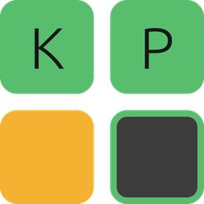
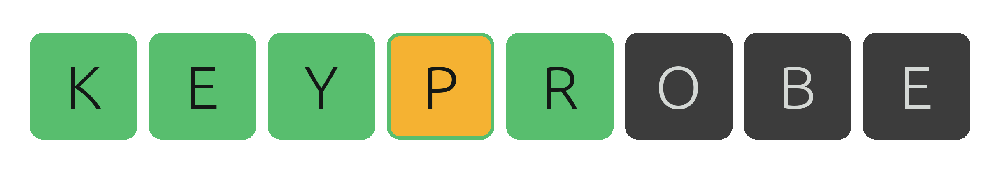
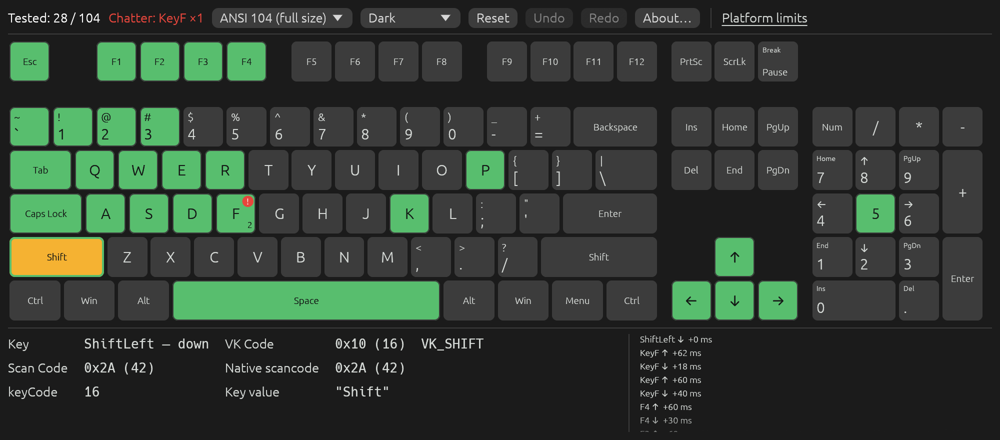
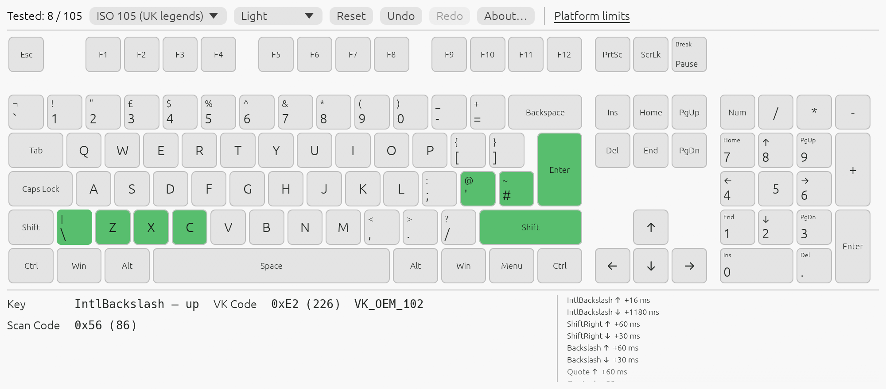
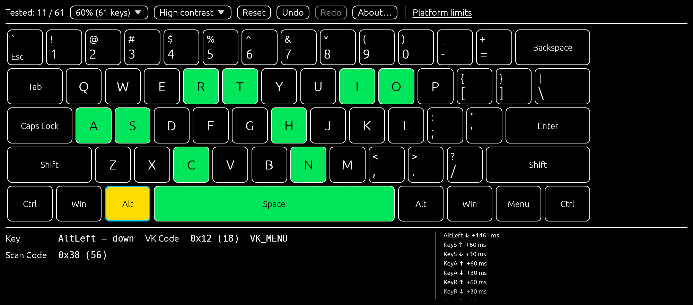

<div align="center">





**KeyProbe lights up every key you press on an on-screen keyboard and shows the codes your system sent for it.**

[](#license)
[](https://doc.rust-lang.org/edition-guide/rust-2024/)
[](https://github.com/emilk/egui)
[](#windows)
[](#linux)
[](#macos)
[](#web)

**[Landing page](https://nazdravan.github.io/keyprobe/)** · [Quick start](#quick-start) · [Features](#features) · [Key codes](#key-codes) ·
[Chatter and stuck keys](#chatter-and-stuck-keys) · [Layouts and themes](#layouts-and-themes) ·
[Changelog](CHANGELOG.md) · [Releases](../../releases) · [Issues](../../issues)

</div>

KeyProbe is an original program, written from scratch in Rust from public specifications. It is
inspired by the features of Keyboard Test Utility; it is not affiliated with it and contains none
of its code.



## Quick start

Each release on the [Releases](../../releases) page has these files:

```
keyprobe-<version>-linux-x86_64.AppImage
keyprobe-<version>-linux-x86_64.deb
keyprobe-<version>-linux-x86_64.tar.gz
keyprobe-<version>-windows-x64.msi
keyprobe-<version>-windows-x64-portable.zip
keyprobe-<version>-macos-universal.dmg
SHA256SUMS.txt
```

**Note: the release workflow has not run yet, so there is no release to download, and the landing
page goes live with the first release.** Until then, build from source (below).

- **Windows 10/11:** run the `.msi`, or unzip the portable `.zip` and start `KeyProbe.exe`. The
  files aren't signed with a paid certificate, so SmartScreen may say "Windows protected your PC":
  choose *More info → Run anyway*.
- **Linux:** `chmod +x keyprobe-*.AppImage` and run it; or `sudo apt install ./keyprobe-*.deb` on
  Debian/Ubuntu; or unpack the `.tar.gz`. Built on Ubuntu 22.04, so glibc 2.35 or newer.
- **macOS 10.13+ (Apple Silicon and Intel):** open the `.dmg` and drag KeyProbe to Applications. The
  app is ad-hoc signed, not notarized: Gatekeeper blocks the first start. Right-click → *Open*, or
  run `xattr -dr com.apple.quarantine /Applications/KeyProbe.app`.

Check a download with `shasum -a 256 -c SHA256SUMS.txt --ignore-missing`.

### From source

1. Install Rust with [rustup](https://rustup.rs). `rust-toolchain.toml` pins the stable
   toolchain and the `wasm32-unknown-unknown` target, so rustup installs both on the first build.
2. Run the desktop app:

   ```sh
   cargo run --release -p keyprobe
   ```

   The binary lands in `target/release/keyprobe` (`keyprobe.exe` on Windows).

3. Or build the web version and serve it:

   ```sh
   cargo install wasm-bindgen-cli --version 0.2.130   # once; must match Cargo.lock
   cargo xtask web                                     # builds into dist/
   python3 -m http.server 8765 -d dist
   ```

   Open <http://localhost:8765/> and click the page, so it has keyboard focus.

---

## Features

| | |
|---|---|
| **On-screen keyboard** | Untested keys are plain, tested keys turn green, held keys amber, stuck keys red. |
| **Key codes** | W3C `code`, Windows virtual-key code and name, PS/2 Set 1 scan code, the raw scan code and key value the system sent, USB HID usage. |
| **Event log** | The last 50 events: down/up, auto-repeat, milliseconds since the previous event. |
| **Chatter detection** | A key pressed again less than 30 ms after its release gets a red badge and a toolbar warning. |
| **Stuck keys** | A key held for more than 5 s turns red. |
| **Layouts** | ANSI 104, ISO 105, TKL 87, 75 % and 60 %. |
| **Themes** | Dark, light and high contrast. |
| **Undo/redo** | For resets and for layout and theme changes. |
| **Platform limits** | A toolbar tooltip lists the keys this OS or browser keeps for itself. |
| **Focus loss** | Held keys are released when the window or tab loses focus, since their key-ups go elsewhere. |

### Key codes

The readout under the keyboard shows the last key: its W3C `code`, the Windows virtual-key code
and name, the PS/2 Set 1 scan code with the extended (`E0`) flag, and the native scan code and key
value your system reported. Keys whose code depends on the active layout (non-US, Japanese, media
keys) carry a note. Hover a key on the keyboard to see its USB HID page and usage.

The key table holds 138 keys, taken only from public specifications:

- [W3C UI Events KeyboardEvent `code` values](https://www.w3.org/TR/uievents-code/)
- [USB HID Usage Tables](https://usb.org/document-library/hid-usage-tables-15)
- Microsoft's [Virtual-Key Codes](https://learn.microsoft.com/en-us/windows/win32/inputdev/virtual-key-codes),
  [Keyboard Scan Code Specification](https://download.microsoft.com/download/1/6/1/161ba512-40e2-4cc9-843a-923143f3456c/scancode.doc)
  and [About Keyboard Input](https://learn.microsoft.com/en-us/windows/win32/inputdev/about-keyboard-input)

### Chatter and stuck keys

A worn switch can register one press as two. When a key goes down again less than 30 ms after
it was released, KeyProbe puts a red `!` on it and a count in the toolbar (`Chatter: KeyF ×1` in
the screenshot above). The event log shows the gap in milliseconds. A key held for more than
5 seconds turns red: either it is stuck, or its key-up never arrived.

### Layouts and themes





Layout and theme are chosen in the toolbar, and both changes can be undone.

### Keyboard shortcuts

KeyProbe has none, on purpose: every key you press is input under test. The app is driven with
the mouse. In the browser, KeyProbe also stops the page from acting on keys (Tab, Space, F5, Alt),
where the browser allows it.

---

## What can't be tested

Some keys never reach an application:

- **Fn** is handled inside the keyboard on every platform.
- **Secure and system shortcuts** (Ctrl+Alt+Del, Win+L, Cmd+Tab, Cmd+Space) are taken by the OS.
- **Print Screen on Windows** usually arrives as key-up only.
- **Caps Lock on macOS** reports a toggle, not separate down and up events.
- **In the browser**, the browser keeps its own shortcuts (Ctrl/Cmd+W, T, N), and keys from virtual
  or IME keyboards without a physical `code` are ignored.

The same list, for the platform you're on, is under **Platform limits** in the toolbar.

Two choices are deliberate. The compact 91- and 72-key layouts of the original are not included,
because they are its own arrangements rather than standards; KeyProbe has the standard ones
instead. The Korean Lang1/Lang2 keys are left out until their Windows codes can be confirmed from
public documentation.

---

## Windows

Built with the MSVC toolchain; `assets/keyprobe.ico` is embedded as the `.exe` icon by
`apps/keyprobe-desktop/build.rs`.

**Note: not yet run on a real Windows machine.** The desktop app passes `cargo clippy -D warnings`
for `x86_64-pc-windows-msvc`.

## Linux

Needs the usual X11/Wayland libraries at build time (`libxkbcommon-dev`, `libwayland-dev`,
`libxcb-*-dev`).

**Note: not yet run on a real Linux machine.** The desktop app passes `cargo clippy -D warnings`
for `x86_64-unknown-linux-gnu`.

## macOS

The `.dmg` holds a universal `KeyProbe.app` (Apple Silicon and Intel, macOS 10.13+), ad-hoc signed
by `packaging/macos/package.sh`. It is not notarized, which needs a paid Apple Developer account;
see Quick start for the first start.

Built and run on macOS, where the window, the control channel and the app's screenshots are
checked.

**Note: physical key presses have so far been checked only through the control channel.**

## Web

eframe's `WebRunner` with capture-phase `keydown`/`keyup` listeners. Checked in Chromium with
synthetic key events (letters, modifiers, NumpadEnter, focus loss); not yet in Firefox or Safari.

---

## Code structure

The workspace is split into layers. A crate depends only on lower layers, and nothing below the UI
layer touches egui, eframe or winit (`cargo xtask layers` enforces it):

| Path | Holds |
|---|---|
| `crates/kp-geom` | L0: rectangles and geometry checks |
| `crates/kp-doc` | L1: document model: key events, test state (presses, held, chatter), view, layout model |
| `crates/kp-keys` | L2: key table (W3C ↔ HID ↔ VK ↔ Set 1) and the five layouts |
| `crates/kp-engine` | L5: session, command registry, undo/redo history, panic guard with rollback |
| `crates/kp-ui` | L6: egui panels (keyboard, readout, event log, toolbar) and themes |
| `crates/kp-control` | L6: localhost control channel (desktop only) |
| `apps/keyprobe-desktop` | L7: eframe on its own winit event loop, raw key capture, window icon |
| `apps/keyprobe-web` | L7: eframe `WebRunner`, browser key listeners, `index.html` |
| `xtask` | `cargo xtask ci`, `layers`, `wasm`, `assets`, `web` |
| `assets/theme.toml` | the one source of colours and fonts for the app, icon and banner |
| `assets/icon.py` | `python3 assets/icon.py`: icon.png, keyprobe.ico, keyprobe.icns, README mark |
| `assets/banner.py` | `python3 assets/banner.py`: the README banner |
| `assets/screenshots.py` | `python3 assets/screenshots.py`: README screenshots, taken by the app |
| `assets/fonts` | Ubuntu Light and Hack, egui's default fonts, with their licences |
| `site/` | the landing page: `python3 site/build.py --release release.json --out _site --app dist` (colours and fonts from `theme.toml`) |
| `packaging/` | release scripts: AppImage, `.deb`, `.tar.gz`, `.msi` (WiX), portable `.zip`, `.dmg` |

The image generators need Python 3.11+ and Pillow.

**Everything is a command.** The UI and the platform shells never change state directly; they call
`app.run(id, params)`:

| Command | Params |
|---|---|
| `key.down` | `{code, repeat?, native?: {scancode?, key_code?, key?}, time_ms?}` |
| `key.up` | `{code, native?, time_ms?}` |
| `key.release_all` | none |
| `test.reset` | none |
| `view.layout` | `{name: "ansi-104" \| "iso-105" \| "tkl-87" \| "75-percent" \| "60-percent"}` |
| `view.theme` | `{name: "dark" \| "light" \| "high-contrast"}` |
| `edit.undo`, `edit.redo` | none |
| `help.about` | none |

Commands never panic. Clippy denies `unwrap`, `expect`, `panic!` and slice indexing outside tests,
and a panic guard rolls the document back if a bug slips through.

### Control channel

The desktop app can be driven over localhost; this is how the screenshots above are made:

```sh
cargo run -p keyprobe -- --control 7878
```

Each request is one JSON line over TCP, and each reply is one line. Besides the commands above, it
accepts `ping`, `commands`, `state` and `ui.screenshot {path}`, a PNG of the window rendered by the
app itself.

```sh
printf '%s\n' '{"id":1,"cmd":"key.down","params":{"code":"KeyA"}}' \
  '{"id":2,"cmd":"ui.screenshot","params":{"path":"/tmp/keyprobe.png"}}' | nc 127.0.0.1 7878
```

## Release

Releases are made by `.github/workflows/release.yml`: a push to `main` with a version in
`Cargo.toml` that isn't published yet builds every package above and publishes the release, with
the notes from [CHANGELOG.md](CHANGELOG.md). `packaging/version.sh set X.Y.Z` changes the version.
Details: [docs/releasing.md](docs/releasing.md).

## Tests

```sh
cargo xtask ci   # fmt, clippy -D warnings, tests, layer check, wasm clippy, assets check
```

`.github/workflows/ci.yml` runs the same gate on Linux, Windows and macOS for every push to `main`
and every pull request.

The landing page has its own tests: `python3 -m unittest discover -s site/tests` and
`node --test site/tests/*.test.mjs`.

The Rust tests cover the key table and layouts (property tests on lookups and geometry), the engine
(undo/redo, panic rollback, property tests on arbitrary command params), the UI panels (headless
egui), key mapping on desktop and web, the control channel and the theme staying in sync with
`assets/theme.toml`.

## License

Licensed under either of

- Apache License, Version 2.0 ([LICENSE-APACHE](LICENSE-APACHE))
- MIT license ([LICENSE-MIT](LICENSE-MIT))

at your option.

Unless you explicitly state otherwise, any contribution intentionally submitted for inclusion in
KeyProbe by you, as defined in the Apache-2.0 license, shall be dual licensed as above, without
any additional terms or conditions.

The bundled fonts keep their own licences: Ubuntu Font Licence (`assets/fonts/UFL.txt`) and the
Hack licence (`assets/fonts/Hack-Regular.txt`).
